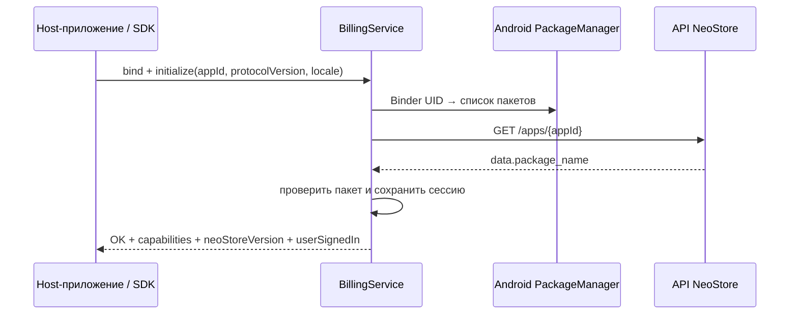
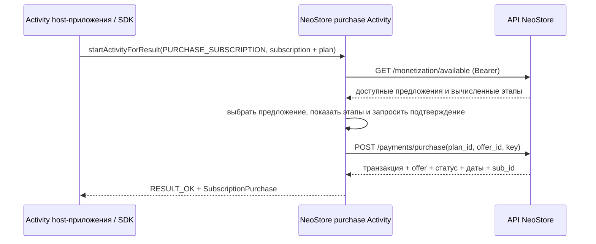
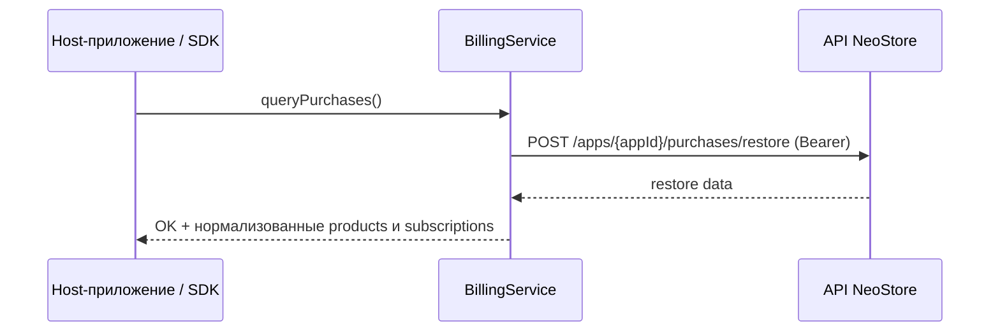
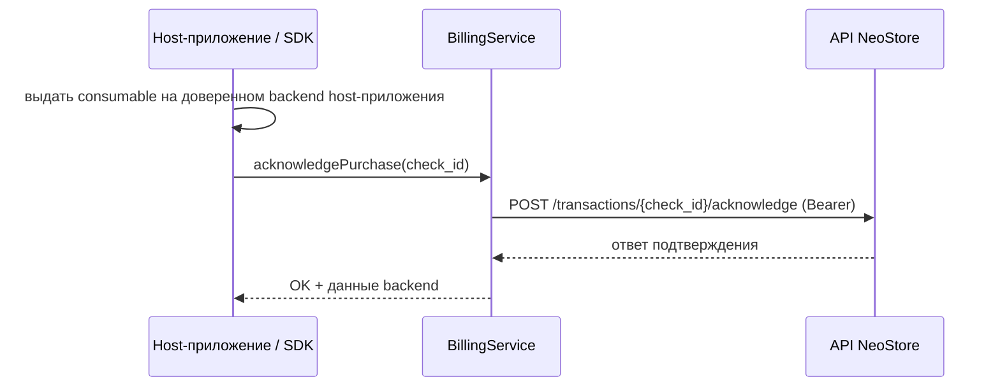
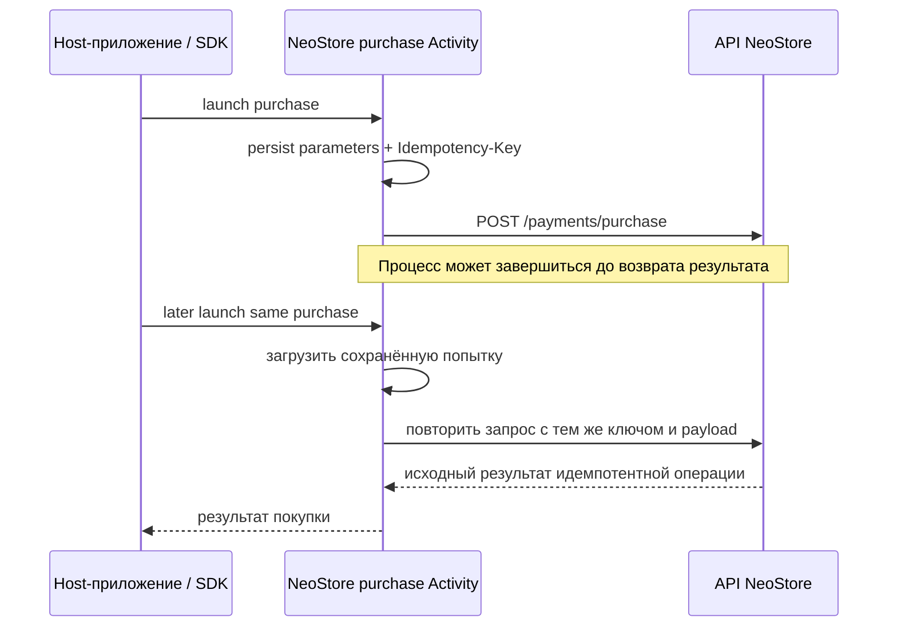

# NeoStore Billing SDK — спецификация для разработчиков

Этот документ предназначен для передачи команде, которая реализует
NeoStore Billing SDK. Он самодостаточен: описывает фактический IPC-контракт
Android-приложения NeoStore и требования к библиотеке. Исходный
`NeoStore_Billing_Agent_Prompt (1).md` — ТЗ на разработку NeoStore, а не
обязательная зависимость команды SDK; при расхождениях приоритет у этого
документа.

**Граница ответственности:** SDK — клиентское Kotlin/Android-обёртывание над
IPC. Он не реализуется в приложении NeoStore, не вызывает backend напрямую,
не получает токены, не выбирает офферы и не проводит оплату. Вызовы
платёжного API и весь пользовательский поток выполняет NeoStore.

**Состояние контракта:** протокол v1 реализован в NeoStore. Совместимость
описана с учётом фактического поведения приложения и обновлённой схемы API.
Неизвестные значения и nullable-поля нужно обрабатывать толерантно.

## 1. Компоненты и обнаружение приложения

Пакет NeoStore: `com.neostudio.neostore`  
Минимальный Android SDK NeoStore: 24  
Версия IPC: `1`  
Транспорт: экспортированный Android-сервис `Messenger` с JSON-строками;
AIDL-файла и Parcelable-моделей биллинга нет.

| Компонент | Объявление в манифесте | Назначение |
|---|---|---|
| Billing-сервис | `com.neostudio.neostore.BillingService`, exported, action `com.neostudio.neostore.billing.BIND` | Методы без UI |
| Billing Activity | `com.neostudio.neostore.InAppPaymentActivity`, exported, actions `com.neostudio.neostore.billing.action.PURCHASE_PRODUCT`, `.PURCHASE_SUBSCRIPTION`, `.SIGN_IN` | Покупка и вход |

Host-приложению нужно объявить видимость пакета:

```xml
<queries>
    <package android:name="com.neostudio.neostore" />
</queries>
```

Для привязки используйте явный Service Intent с action сервиса и
`setPackage("com.neostudio.neostore")`. Activity также запускайте явным Intent
и с получением результата (`startActivityForResult` или
`ActivityResultContract`), чтобы NeoStore получил `getCallingPackage()`.
Запуск через обычный `startActivity()` не поддерживается.

Проверка доступности выполняется локально в SDK через `PackageManager`.
Надёжно можно определить `AVAILABLE`, `NOT_INSTALLED` и `DISABLED`.
NeoStore не публикует минимальную поддерживаемую версию, поэтому
`UPDATE_REQUIRED` нельзя вывести только из номера версии; несовместимость
протокола определяется по `UNSUPPORTED_PROTOCOL` и capabilities.
Отсутствующий/недоступный сервис означает `SERVICE_UNAVAILABLE`.
Управления подписками в UI NeoStore и соответствующей capability нет.

## 2. Формат Messenger-сообщений

Свяжитесь с сервисом по `BillingService.ACTION_BIND`. Каждый запрос —
Android `Message` с `what = 1`, непустым Messenger в `replyTo` и Bundle:

| Bundle-ключ | Тип | Значение |
|---|---|---|
| `requestJson` | String | JSON-объект запроса в UTF-8 |

NeoStore отвечает `Message` с `what = 1` и Bundle:

| Bundle-ключ | Тип | Значение |
|---|---|---|
| `responseJson` | String | Конверт ответа в JSON |

Если запрос содержит `requestId`, NeoStore копирует его в корневое поле
ответа. Хотя текущий сервис не требует это поле, SDK должен генерировать
уникальный ID и использовать его для сопоставления параллельных ответов.
Сервис обрабатывает IPC асинхронно и может ответить не в порядке отправки.

Все ответы имеют такой конверт:

```json
{
  "protocolVersion": 1,
  "responseCode": "OK",
  "responseCodeValue": 0,
  "debugMessage": null,
  "data": {}
}
```

Невалидный JSON приводит к `DEVELOPER_ERROR`; неизвестный метод — тоже к
`DEVELOPER_ERROR`. Дополнительные поля запроса игнорируются. Каждый запрос, кроме отдельно проверяемого `initialize`, должен содержать
`protocolVersion: 1`.

## 3. Инициализация и идентификация вызывающего

`initialize` — единственный метод, принимающий `appId`. Это должен быть
положительный целочисленный ID. NeoStore получает UID вызывающего из Binder,
запрашивает его пакеты у Android `PackageManager`, загружает
`GET /apps/{appId}` и проверяет, что `package_name` на сервере совпадает с
одним из пакетов, полученных от ОС. После проверки NeoStore сохраняет
соответствие «пакет → appId». Последующие IPC-вызовы и Activity не принимают
`appId`.

Запрос:

```json
{
  "method": "initialize",
  "protocolVersion": 1,
  "requestId": "init-1",
  "appId": 13,
  "sdkVersion": "1.0.0",
  "locale": "ru-RU",
  "debug": false
}
```

`sdkVersion` и `debug` принимаются, но сейчас не используются. Параметр
`locale` необязателен; он сохраняется для локализации каталога и UI оплаты.

Данные успешного ответа:

```json
{
  "protocolVersion": 1,
  "capabilities": [
    "getCatalog",
    "queryPurchases",
    "getSubscription",
    "acknowledgePurchase",
    "purchaseProduct",
    "purchaseSubscription",
    "signIn"
  ],
  "neoStoreVersion": "0.1.7",
  "userSignedIn": true
}
```

Невалидный ID, отсутствие идентифицируемого пакета ОС или несовпадение пакета
возвращают `DEVELOPER_ERROR`. Сейчас поддерживается только протокол v1; иная
версия возвращает `UNSUPPORTED_PROTOCOL`.

## 4. Методы сервиса без UI

Каждый вызов содержит `method`, `protocolVersion: 1` и, опционально,
`requestId`. Методы, требующие входа, возвращают `NOT_SIGNED_IN`, если в
NeoStore нет действительного Sanctum-токена.

### `getCatalog`

Запрос:

```json
{"method":"getCatalog","protocolVersion":1,"requestId":"catalog-1"}
```

Вызывает публичный `GET /apps/{appId}/monetization`. DTO для SDK использует
camelCase, цены передаются десятичными строками, а также добавляется
локализованный `formattedPrice`. Внутренние ID объектов скрыты. Предложения
(`offers`) в ответ не включаются.

```json
{
  "protocolVersion": 1,
  "responseCode": "OK",
  "responseCodeValue": 0,
  "debugMessage": null,
  "data": {
    "appId": 13,
    "products": [{
      "identifier": "remove_ads",
      "name": "Remove ads",
      "type": "NON_CONSUMABLE",
      "price": "49.00",
      "currency": "RUB",
      "formattedPrice": "49,00 ₽"
    }],
    "subscriptions": [{
      "identifier": "premium",
      "name": "Premium",
      "plans": [{
        "identifier": "monthly",
        "billingType": "AUTO_RENEWING",
        "periodValue": 1,
        "periodUnit": "MONTH",
        "price": "99.00",
        "currency": "RUB",
        "formattedPrice": "99,00 ₽"
      }]
    }]
  }
}
```

Поле `description` может отсутствовать или быть `null`. Неизвестные типы
товаров и тарифов SDK должен хранить как неизвестные значения enum, а не
считать ошибкой разбора.

### `queryPurchases`

Запрос:

```json
{"method":"queryPurchases","protocolVersion":1,"requestId":"restore-1"}
```

Вызывает `POST /apps/{appId}/purchases/restore` и нормализует документированные
`data.purchases` и `data.subscriptions`. Для товаров возвращается массив
`products`; для подписок — массив `subscriptions`. Требуется вход в NeoStore.

```json
{
  "products": [{
    "kind": "PRODUCT",
    "transactionId": "check_ef2d1b89c0d7e1c2",
    "productIdentifier": "remove_ads",
    "productName": "Remove ads",
    "productType": "NON_CONSUMABLE",
    "status": "PAID",
    "deliveryStatus": "acknowledged",
    "acknowledgedAt": "2026-11-03T20:45:00Z",
    "acknowledged": true,
    "amount": null,
    "currency": null
  }],
  "subscriptions": [{
    "kind": "SUBSCRIPTION",
    "transactionId": null,
    "subscriptionId": "sub_368d7d2d8e21",
    "subscriptionIdentifier": "premium",
    "subscriptionName": "Premium",
    "planIdentifier": "premium_month",
    "planName": "Monthly",
    "status": "ACTIVE",
    "autoRenewing": false,
    "amount": null,
    "currency": null,
    "startedAt": "2026-10-31T00:00:00Z",
    "expiresAt": "2026-11-30T00:00:00Z",
    "nextBillingAt": null,
    "cancelledAt": "2026-11-03T20:45:00Z",
    "currentPhaseOrder": 1,
    "appliedOffer": null
  }]
}
```

Restore содержит подтверждённые `NON_CONSUMABLE` и ожидающие выдачи
`CONSUMABLE`; подтверждённые consumable не возвращаются как ожидающие.
Подписка с отключённым автопродлением остаётся `ACTIVE` до окончания
оплаченного периода. Статусы SDK: `ACTIVE`, `PAST_DUE`, `EXPIRED`, `REVOKED`;
неизвестное значение преобразуется в `UNKNOWN`.

### `getSubscription`

Запрос:

```json
{
  "method":"getSubscription",
  "protocolVersion":1,
  "requestId":"subscription-1",
  "subscriptionId":"sub_abc123"
}
```

Принимаются только ID, соответствующие `sub_[A-Za-z0-9]+`. Сервис вызывает
авторизованный `GET /subscriptions/{sub_id}`; сервер ограничивает запись
владельцем, а NeoStore дополнительно проверяет, что `app_id` совпадает с
приложением текущей сессии. Результат — нормализованный
`SubscriptionPurchase`, где `transactionId` и `appliedOffer` равны `null`.
Статус подписки возвращается в верхнем регистре. `active` с отключённым
автопродлением остаётся `ACTIVE`; отмена передаётся через `autoRenewing` и
`cancelledAt`.

```json
{
  "kind":"SUBSCRIPTION",
  "transactionId":null,
  "subscriptionId":"sub_abc123",
  "subscriptionIdentifier":"premium",
  "planIdentifier":"monthly",
  "status":"ACTIVE",
  "autoRenewing":true,
  "billingType":"AUTO_RENEWING",
  "amount":"99.00",
  "currency":"RUB",
  "startedAt":"2026-01-01T00:00:00Z",
  "expiresAt":"2026-02-01T00:00:00Z",
  "nextBillingAt":"2026-02-01T00:00:00Z",
  "cancelledAt":null,
  "appliedOffer":null
}
```

### `acknowledgePurchase`

Запрос:

```json
{
  "method":"acknowledgePurchase",
  "protocolVersion":1,
  "requestId":"ack-1",
  "transactionId":"check_abc123"
}
```

Принимаются только ID формата `check_[A-Za-z0-9]+`. Вызывается
`POST /apps/{appId}/transactions/{check_id}/acknowledge`; `data` содержит
`delivery_status: "acknowledged"` и время подтверждения. Метод идемпотентен.
Используйте только для consumable после того, как разработчик host-приложения
выдал товар.

## 5. Публичная Activity биллинга

Activity экспортирована; запускайте её из host Activity с получением
результата. Укажите `action` в Intent и целочисленный
`protocolVersion: 1`.

| Action Intent | Обязательные строковые extras |
|---|---|
| `com.neostudio.neostore.billing.action.PURCHASE_PRODUCT` | `productIdentifier` |
| `com.neostudio.neostore.billing.action.PURCHASE_SUBSCRIPTION` | `subscriptionIdentifier`, `planIdentifier` |
| `com.neostudio.neostore.billing.action.SIGN_IN` | Нет |

Пример:

```kotlin
val intent = Intent("com.neostudio.neostore.billing.action.PURCHASE_PRODUCT")
    .setPackage("com.neostudio.neostore")
    .putExtra("protocolVersion", 1)
    .putExtra("productIdentifier", "remove_ads")
activity.startActivityForResult(intent, REQUEST_BILLING)
```

`appId` берётся из сессии для вызывающего пакета, определённого ОС; из extras
он не принимается. Отсутствие `callingPackage` или сессии приводит к
`DEVELOPER_ERROR`.

Обычно результат Activity содержит строковый extra `billingResult` с тем же
JSON-конвертом. `RESULT_OK` используется только для `responseCode=OK`;
остальные исходы используют `RESULT_CANCELED`, часто с конвертом ошибки в
результате. Если Activity закрылась без Intent результата, SDK трактует это
как `USER_CANCELED`.

Перед отправкой покупки NeoStore показывает системное подтверждение через
`BiometricPrompt`, если на устройстве настроена защищённая блокировка:
доступную сильную биометрию и/или PIN-код, пароль либо графический ключ.
Если пользователь отменил подтверждение или оно завершилось ошибкой, запрос
покупки не отправляется. Если безопасная блокировка устройства не настроена,
системный запрос аутентификации не показывается.

Шторка также получает баланс из авторизованного `GET /balance`; это только
информация для пользователя. Списание проверяет и выполняет серверный
`POST /payments/purchase`.

Данные успешной покупки товара:

```json
{
  "kind":"PRODUCT",
  "transactionId":"check_ef2d1b89c0d7e1c2",
  "productIdentifier":"remove_ads",
  "productType":"NON_CONSUMABLE",
  "status":"PAID",
  "amount":"49.00",
  "currency":"RUB",
  "purchasedAt":"2026-01-01T00:00:00Z",
  "acknowledged":false
}
```

Успешная подписка возвращает `SubscriptionPurchase`, описанный в разделе 4.
`appliedOffer` строится из `offer_id` и `offer_identifier` ответа покупки и
дополняется именем выбранного предложения из каталога. Статус подписки,
`expiresAt`, `nextBillingAt` и публичный `subscriptionId` берутся из ответа
покупки; для завершения покупки дополнительный lookup не требуется.
Для товара NeoStore может обогатить результат публичными данными транзакции.
Этот lookup необязательный: при его недоступности `purchasedAt` будет `null`,
а `acknowledged` не следует использовать как подтверждение выдачи на backend
host-приложения.
`ALREADY_OWNED` содержит нормализованную существующую покупку из restore.

Предложения загружаются внутри NeoStore для текущего пользователя. SDK их не
получает и не выбирает `offer_id`. NeoStore выбирает подходящее предложение
по детерминированным правилам реализации и передаёт `offer_id` только в
запрос покупки. Если сервер вернул распознанную ошибку 422 по предложению,
NeoStore обновляет условия и просит пользователя подтвердить их заново.

## 6. Коды ответа

`responseCodeValue` стабилен в рамках протокола v1. Неизвестные имена и
числовые коды нужно преобразовывать в `ERROR`, сохраняя исходное значение
для диагностики.

| Имя | Значение | Действия SDK/host-приложения |
|---|---:|---|
| `OK` | 0 | Прочитать данные; проверить/выдать товар на backend host-приложения; затем подтвердить consumable |
| `USER_CANCELED` | 1 | Ошибку пользователю показывать не обязательно |
| `NOT_SIGNED_IN` | 2 | Запустить `SIGN_IN`, затем предложить пользователю повторить действие |
| `ITEM_UNAVAILABLE` | 3 | Обновить каталог и скрыть/отключить объект |
| `ALREADY_OWNED` | 4 | Восстановить право доступа; не покупать повторно |
| `INSUFFICIENT_FUNDS` | 5 | Сообщить о нехватке баланса NeoStore; ждать пользователя |
| `OFFER_UNAVAILABLE` | 6 | Показать изменившиеся условия; продолжать только после подтверждения |
| `NETWORK_ERROR` | 7 | При неопределённом исходе оплаты проверить покупки до нового вызова |
| `SERVICE_UNAVAILABLE` | 8 | Повторить позже; не запускать немедленную оплату повторно |
| `RATE_LIMITED` | 9 | Выждать; не повторять сразу |
| `DEVELOPER_ERROR` | 10 | Исправить аргументы, инициализацию, идентификацию пакета или запуск Activity |
| `UNSUPPORTED_PROTOCOL` | 11 | Обновить SDK или NeoStore до совместимых версий |
| `ERROR` | 12 | Показать общее сообщение; для диагностики можно использовать `debugMessage` |

Текущее сопоставление HTTP: 401→`NOT_SIGNED_IN`; 404→`ITEM_UNAVAILABLE`;
409→`DEVELOPER_ERROR`; 429→`RATE_LIMITED`; 5xx→`SERVICE_UNAVAILABLE`;
422 с упоминанием offer→`OFFER_UNAVAILABLE`, недостатка средств/balance →
`INSUFFICIENT_FUNDS`, иначе→`DEVELOPER_ERROR`; остальные статусы→`ERROR`.
Сетевые ошибки ввода-вывода дают `NETWORK_ERROR`.

Пример неизвестного/неподдерживаемого ответа:

```json
{
  "protocolVersion":1,
  "responseCode":"SOME_FUTURE_CODE",
  "responseCodeValue":99,
  "debugMessage":"SOME_FUTURE_CODE",
  "data":null
}
```

## 7. Безопасность, надёжность и совместимость

- Идентичность вызывающего определяется только через Binder UID и
  `PackageManager` для сервиса, либо через `getCallingPackage()` для Activity.
- `appId` принимается только при инициализации и проверяется по
  `package_name` сервера. Имя пакета, переданное SDK, не считается надёжным.
- Цена, сумма, валюта, user ID, признак подписки, срок и выбор предложения
  не принимаются от SDK и не являются частью контракта.
- Sanctum-токен остаётся в NeoStore; его нельзя возвращать host-приложению
  или записывать в логи биллинга.
- Activity использует `FLAG_SECURE` и фильтрацию перекрытых касаний для
  интерактивных элементов. Сервис подавляет одинаковые запросы, пришедшие
  в пределах 400 мс.
- Запрос покупки использует сохранённый UUID `Idempotency-Key` и сохранённые
  параметры. При неопределённом сетевом результате повтор использует те же
  ключ и payload; после подтверждённой терминальной ошибки валидации они
  удаляются. SDK не должен автоматически повторять покупку.
- Во время обработки платежа шторку нельзя закрыть. Если процесс NeoStore
  завершился, следующий запуск той же покупки восстанавливает сохранённую
  попытку. Потеря процесса host-приложения не сопровождается callback от
  NeoStore; SDK следует запрашивать покупки при старте/возврате.
- В протоколе v1 нет диапазона согласования версий или согласования
  capabilities вперёд. Сохраняйте неизвестные поля, допускайте отсутствие
  необязательных и проверяйте `capabilities` из `initialize`.
- Сейчас `debug` не управляет логированием. Не раскрывайте персональные
  данные или токены в логах SDK.

## 8. Диаграммы последовательностей

### Инициализация



### Покупка товара

```mermaid
sequenceDiagram
  participant H as Activity host-приложения / SDK
  participant U as NeoStore purchase Activity
  participant A as API NeoStore
  H->>U: startActivityForResult(PURCHASE_PRODUCT, identifier)
  U->>A: GET приложения + персонализированный каталог
  A-->>U: товар + цена
  U->>U: показать подтверждение; сохранить попытку и idempotency key
  U->>A: POST /payments/purchase(app_id, product_id, key)
  A-->>U: оплаченная транзакция
  opt Обогащение результата товара
    U->>A: GET /developers/transactions/{check_id}
    A-->>U: публичные данные транзакции
  end
  U-->>H: RESULT_OK + billingResult(ProductPurchase)
```

### Подписка с предложением



### Восстановление покупок



### Подтверждение consumable



### Недостаточно средств

```mermaid
sequenceDiagram
  participant U as NeoStore purchase Activity
  participant A as API NeoStore
  participant H as Host-приложение / SDK
  U->>A: POST /payments/purchase
  A-->>U: 422 — недостаточно средств
  U->>U: преобразовать в INSUFFICIENT_FUNDS; оставить шторку открытой
  U-->>H: RESULT_CANCELED + billingResult
  H->>H: показать сообщение и ждать пользователя
```

### Завершение процесса во время платежа



## 9. Проверка host-приложением и серверная верификация

SDK — транспортный адаптер и средство запуска UI, а не источник истины о
покупках. Разработчикам host-приложений следует проверять ID транзакций на
своём backend через публичный
`GET /developers/transactions/{check_id}`, а ID подписок — через
`GET /developers/subscriptions/{sub_id}`, прежде чем выдавать постоянный
доступ. Обрабатывайте webhooks, например `purchase.completed`,
`subscription.renewed` и `subscription.cancelled`. Одного клиентского
`RESULT_OK` недостаточно для доверенной выдачи товара.

У NeoStore нет push-канала SDK. Запрашивайте покупки при старте и возвращении
приложения. DTO restore нормализуется по документированной схеме API; см.
раздел `queryPurchases`.

## 10. Требования к библиотеке SDK

Этот раздел — спецификация того, что команда должна реализовать и поставить.
Разделы 1–9 выше являются точным протоколом взаимодействия с NeoStore.

### 10.1. Роль, публичный API и границы

Библиотека должна быть тонкой Kotlin-обёрткой над Android IPC:

- Синхронно проверить доступность пакета и асинхронно выполнять сетевые через
  NeoStore операции.
- Предоставить типизированные модели и стабильный enum `ResponseCode`.
- Запускать покупку и вход только через Activity с результатом.
- Не обращаться к API Laravel напрямую, не хранить/запрашивать Sanctum-токен,
  не назначать цены, не выбирать offer и не считать себя источником прав на
  контент.
- Не реализовывать `openSubscriptionManagement`: такой capability и экран
  сейчас отсутствуют.

Рекомендуемая форма API (названия можно согласовать с Java/Kotlin ergonomics,
но семантика обязательна):

```kotlin
object NeoStoreBilling {
    fun checkAvailability(context: Context): NeoStoreAvailability
    suspend fun initialize(
        context: Context,
        config: NeoStoreBillingConfig
    ): BillingResult<InitInfo>
    fun setPurchasesListener(listener: PurchasesListener?)
    suspend fun getCatalog(): BillingResult<Catalog>
    suspend fun purchaseProduct(
        activity: Activity,
        productIdentifier: String
    ): BillingResult<ProductPurchase>
    suspend fun purchaseSubscription(
        activity: Activity,
        subscriptionIdentifier: String,
        planIdentifier: String
    ): BillingResult<SubscriptionPurchase>
    suspend fun queryPurchases(): BillingResult<PurchasesSnapshot>
    suspend fun getSubscription(subscriptionId: String): BillingResult<SubscriptionPurchase>
    suspend fun acknowledgePurchase(transactionId: String): BillingResult<Unit>
    suspend fun signIn(activity: Activity): BillingResult<Unit>
    fun release()
}

data class NeoStoreBillingConfig(
    val appId: Long,
    val locale: Locale? = null,
    val debug: Boolean = false
)

data class BillingResult<out T>(
    val responseCode: ResponseCode,
    val debugMessage: String?,
    val data: T?
)
```

Для Java callers предоставить удобные фасады (`@JvmStatic`,
`@JvmOverloads` и/или callback API); callback всегда вызывается на main
thread. Поддержать одну активную интерактивную операцию на SDK instance.

### 10.2. Модели и правила разбора

Минимальный набор публичных моделей:

- `NeoStoreAvailability`: `AVAILABLE`, `NOT_INSTALLED`, `DISABLED`,
  `UPDATE_REQUIRED`. Последнее значение — зарезервировано: NeoStore не
  объявляет минимальную версию, поэтому SDK не должен выдумывать порог.
- `InitInfo`: `protocolVersion`, `capabilities`, `neoStoreVersion`,
  `userSignedIn`.
- `Catalog`: список `ProductInfo` и `SubscriptionInfo`; у подписки есть
  список `PlanInfo`. Не выдавать SDK ID каталога или offers.
- `ProductInfo`: `identifier`, `name`, nullable `description`, `type`,
  `price`, `currency`, `formattedPrice`.
- `PlanInfo`: `identifier`, `name`, nullable `description`, `billingType`,
  `periodValue`, `periodUnit`, `price`, `currency`, `formattedPrice`.
- `ProductPurchase`: `transactionId`, `productIdentifier`, `productName?`,
  `productType`, `status`, `deliveryStatus?`, `acknowledgedAt?`,
  `amount?`, `currency?`, `purchasedAt?`, `acknowledged`.
- `SubscriptionPurchase`: `transactionId?`, `subscriptionId`,
  `subscriptionIdentifier?`, `subscriptionName?`, `planIdentifier?`,
  `planName?`, `status`, `autoRenewing`, `billingType?`, `amount?`,
  `currency?`, `startedAt?`, `expiresAt?`, `nextBillingAt?`,
  `cancelledAt?`, `currentPhaseOrder?`, `appliedOffer?`.
- `AppliedOffer?`: `id?`, `identifier?`, `name?`. На restore и
  `getSubscription` значение `null`; после покупки может быть заполнено по
  ответу операции и выбранному NeoStore offer.
- `PurchasesSnapshot`: `products: List<ProductPurchase>` и
  `subscriptions: List<SubscriptionPurchase>`.

Статусы подписки: `ACTIVE`, `PAST_DUE`, `EXPIRED`, `REVOKED`, `UNKNOWN`.
`CANCELLED` не является backend-статусом: отключённое автопродление остаётся
`ACTIVE` до окончания оплаченного доступа; различие представляют
`autoRenewing=false` и `cancelledAt`. Для товарного статуса известное
`paid` нормализуется в `PAID`; неизвестные значения хранить как `UNKNOWN`
или сохранить исходную строку в модели.

Деньги передавать строками или `BigDecimal` — никогда `Float`/`Double`.
Время передавать ISO-8601 или `Instant`. JSON-разбор толерантный: неизвестные
поля игнорировать; необязательные/null поля не должны ломать разбор;
неизвестный `responseCode` преобразовать в `ERROR`, сохранив исходное
значение в диагностике; неизвестные type/status не должны приводить к
падению.

Важно: restore возвращает `products` и `subscriptions` как описано в
разделе 4. Для restore-сущностей продукта `amount` и `currency` могут быть
`null`; модель должна это допускать. Ожидающие подтверждения consumable
присутствуют в restore; подтверждённые consumable не возвращаются как
ожидающие. Restore повторяемый, не создаёт платежей и не меняет
acknowledgement.

### 10.3. Соединение, потоки и lifecycle

- Использовать явный `Intent` для `BillingService.ACTION_BIND`, обрабатывать
  `ServiceConnection`, смерть Binder, `onServiceDisconnected`,
  `onBindingDied` и повторное подключение при следующем вызове.
- Ограничить таймаут подключения (например, 5 секунд) и таймаут IPC-вызова
  (15–20 секунд); использовать ограниченные повторы только для подключения,
  не для операций покупки.
- Вызовы могут поступать с любого потока. Состояние соединения и
  сопоставление pending requests защищены; JSON и IPC не выполняются на main
  thread. Использовать уникальный `requestId`, ожидать ответ matching id и
  учитывать, что ответы могут приходить не по порядку.
- Запросы во время подключения можно поставить в очередь; ошибки bind,
  timeout, malformed response и разрыв Binder должны возвращать явный
  `BillingResult`, не маскироваться успешным пустым объектом.
- Хранить `applicationContext` для долгоживущего соединения. Не удерживать
  Activity; для UI использовать явное короткоживущее владение Activity,
  launcher или `WeakReference` и очищать ссылки после результата.
- `release()` безопасен при повторном вызове: закрывает соединение,
  отменяет pending callbacks, очищает кэш/слушатель. После `release()`
  разрешён новый `initialize()`.
- Debounce/single-flight допускается для одинаковых read-only запросов
  (`getCatalog`, `queryPurchases`, `getSubscription`); не объединять
  пользовательские покупки.

### 10.4. Инициализация, доступность и capabilities

Порядок интеграции:

1. `checkAvailability(context)`.
2. Если `AVAILABLE`, вызвать `initialize(config)`.
3. Проверить возвращённые `protocolVersion` и `capabilities`.
4. Использовать только методы, перечисленные в capabilities.
5. При завершении интеграции вызвать `release()`.

`initialize` передаёт `appId: Long > 0`, `protocolVersion: 1`,
`sdkVersion` (SemVer), необязательную локаль BCP-47 и `debug`. NeoStore
сверяет OS-идентифицированный пакет с `GET /apps/{appId}.package_name` и
сохраняет соответствие пакета и appId. Повторный initialize с той же
конфигурацией не должен ломать сессию. До успешного initialize все методы
возвращают `DEVELOPER_ERROR`; не пытаться обращаться к приватному API
самостоятельно.

NeoStore принимает только точную `protocolVersion: 1`, а не диапазон.
Отправлять ровно поддерживаемую версию; при `UNSUPPORTED_PROTOCOL`
прекратить вызов и рекомендовать совместимое обновление. Минимальный
NeoStore SDK — Android API 24. Библиотека SDK должна выбрать совместимый
minSdk (не ниже 24) и при использовании `java.time` на более ранних Android
подключить core library desugaring либо оставить время ISO-строками.

Текущие capabilities:

| Capability | SDK-метод |
|---|---|
| `getCatalog` | `getCatalog()` |
| `queryPurchases` | `queryPurchases()` |
| `getSubscription` | `getSubscription(id)` |
| `acknowledgePurchase` | `acknowledgePurchase(id)` |
| `purchaseProduct` | `purchaseProduct(Activity, identifier)` |
| `purchaseSubscription` | `purchaseSubscription(Activity, subscription, plan)` |
| `signIn` | `signIn(Activity)` |

`openSubscriptionManagement` не входит в список и не должен объявляться
доступным по умолчанию.

### 10.5. Покупки, вход, восстановление, acknowledgement

- Перед покупкой SDK запускает точный Intent action из раздела 5, всегда с
  `startActivityForResult`/Activity Result API. Использовать только одну
  активную интерактивную операцию; вторую параллельную отклонять
  `DEVELOPER_ERROR`.
- Не передавать `appId` в Activity, package name, цену, валюту, сумму,
  user ID, тип покупки, срок, offer ID или idempotency key. Эти данные либо
  устанавливает OS/сессия, либо выбирает/считает NeoStore.
- Не выполнять автоматический повтор оплаты. Idempotency-Key и повтор
  неопределённого POST принадлежат NeoStore. Если результат покупки потерян
  или вернулась сетевая ошибка с неопределённым исходом, запросить
  `queryPurchases()` и сверить состояние до следующего платежа,
  инициированного пользователем.
- При `RESULT_OK` разобрать `billingResult` и проверить `responseCode=OK`.
  При `RESULT_CANCELED` payload может содержать полезный код и покупку
  (`ALREADY_OWNED` в том числе) — всегда разбирать его. `RESULT_CANCELED` без
  payload трактовать как `USER_CANCELED`; `RESULT_OK` без корректного JSON —
  `ERROR`.
- Если пользователь не вошёл, Activity покупки предлагает вход в том же
  потоке. Для методов без UI `NOT_SIGNED_IN` возвращается SDK; приложение
  разработчика само решает, вызвать ли `signIn()` и повторить действие.
- После успешной выдачи consumable на доверенном сервере разработчика
  вызвать `acknowledgePurchase(transactionId)`. Не подтверждать выдачу до
  фактической доставки. Повтор acknowledgement безопасен.
- После initialize и при возвращении host app на передний план SDK должен
  инициировать `queryPurchases()` с debounce. Если используется
  `PurchasesListener`, он получает снимок/элементы, найденные восстановлением;
  не обещать exactly-once callback. Host app должна сама сделать выдачу
  идемпотентной и сверять покупки на backend разработчика.

### 10.6. Обработка ошибок

Использовать числовые значения `ResponseCode` из раздела 6. Для неизвестных
значений — `ERROR`. Не скрывать transport errors, не повторять немедленно
`RATE_LIMITED`, `SERVICE_UNAVAILABLE` или `UNSUPPORTED_PROTOCOL`.

| Результат | Поведение SDK и рекомендация host app |
|---|---|
| `OK` | Вернуть модель. Выдать покупку на backend разработчика; для consumable после выдачи вызвать acknowledgement. |
| `USER_CANCELED` | Вернуть отмену; не показывать как системную ошибку. |
| `NOT_SIGNED_IN` | Для UI-потока можно вызвать `signIn()`, затем повторить действие по решению пользователя. |
| `ITEM_UNAVAILABLE` | Обновить каталог и скрыть/отключить объект. |
| `ALREADY_OWNED` | Вернуть `data`; восстановить право, не создавать новую покупку. |
| `INSUFFICIENT_FUNDS` | Сообщить о нехватке баланса; новая покупка только после действия пользователя. |
| `OFFER_UNAVAILABLE` | NeoStore обновил условия и дождался повторного подтверждения; если возвращён этот код, не повторять автоматически. |
| `NETWORK_ERROR` | При покупке проверить restore до новой покупки. |
| `SERVICE_UNAVAILABLE` | Сообщить о временной недоступности; повторить позже, не делать немедленный retry. |
| `RATE_LIMITED` | Выждать; не делать немедленный retry. |
| `DEVELOPER_ERROR` | Исправить интеграцию/аргументы, appId, initialize или запуск Activity; использовать `debugMessage` только для диагностики. |
| `UNSUPPORTED_PROTOCOL` | Остановить операцию и предложить обновить SDK/NeoStore до совместимых версий. |
| `ERROR` | Вернуть ошибку с безопасной диагностикой; пользователю показать общее сообщение. |

Внутреннее сопоставление HTTP описано в разделе 6, но SDK не должен
интерпретировать HTTP или вызывать эти endpoints сам.

### 10.7. Безопасность и Android manifest

В manifest host-приложения/SDK merger добавить только видимость пакета:

```xml
<queries>
    <package android:name="com.neostudio.neostore" />
</queries>
```

Не добавлять `INTERNET` или `QUERY_ALL_PACKAGES` от имени SDK. Не экспортировать
собственные компоненты SDK и не принимать непроверенные сторонние Intent.
Определение приложения выполняется NeoStore через Binder UID и Android
PackageManager, не по package extra. API пока не возвращает digest
сертификата вызывающего приложения; это ограничение принадлежит серверной
интеграции, а не повод передавать package name из SDK.

В release-логах не писать JSON payload/ответы, идентификаторы пользователя,
токены или подробные `debugMessage`. Не логировать цену/сумму как
персональные данные, если это не нужно для продукта. При `debug=true`
разрешена расширенная диагностика без секретов и персональных данных.

При публикации библиотеки включить consumer ProGuard/R8 rules для публичных
моделей и enum, чтобы minified host-приложения сохраняли корректный JSON
mapping. Зависимости держать лёгкими: `org.json`/serialization,
`kotlinx.coroutines`, AndroidX Activity и нужные AndroidX lifecycle utilities.

### 10.8. Проверки и комплект поставки

Поставить AAR/Maven-артефакт, README с быстрым стартом, CHANGELOG и таблицу
совместимости SDK/protocol/NeoStore; добавить Fake для host unit-тестов и
sample-приложение. Покрыть тестами:

- JSON parsing/nullability/unknown enum и коды ошибок;
- доступность, initialize, отсутствующий/неподдерживаемый сервис;
- параллельные запросы, requestId, timeout, disconnect/rebind;
- запуск Activity, RESULT_OK, отмену, ALREADY_OWNED и повреждённый payload;
- single-flight/debounce read-only вызовов и защиту от второй покупки;
- recovery через restore после потери результата, выдачу и acknowledge
  consumable;
- интеграцию с `billing-sandbox`: catalog, вход, покупка товара/подписки,
  restore, подписка по ID, acknowledge, нехватка средств и ошибки.

### 10.9. Ограничения текущей интеграции

- NeoStore не сообщает минимальную поддерживаемую версию, поэтому
  `UPDATE_REQUIRED` нельзя вычислить заранее; используйте protocol result и
  capabilities.
- Нет UI/capability управления подписками, SDK push-канала подписочных
  событий и backend-поля для проверки signing certificate digest.
- API не документирует путь пополнения баланса. NeoStore показывает текущий
  баланс, но SDK не может запустить пополнение.
- Backend не определил entitlement policy для `past_due`; host app не должна
  считать его эквивалентом `ACTIVE` или `EXPIRED` без своей серверной политики.
